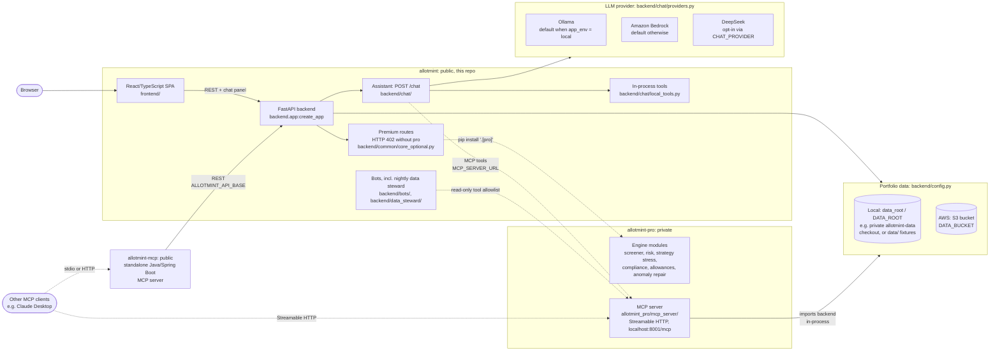
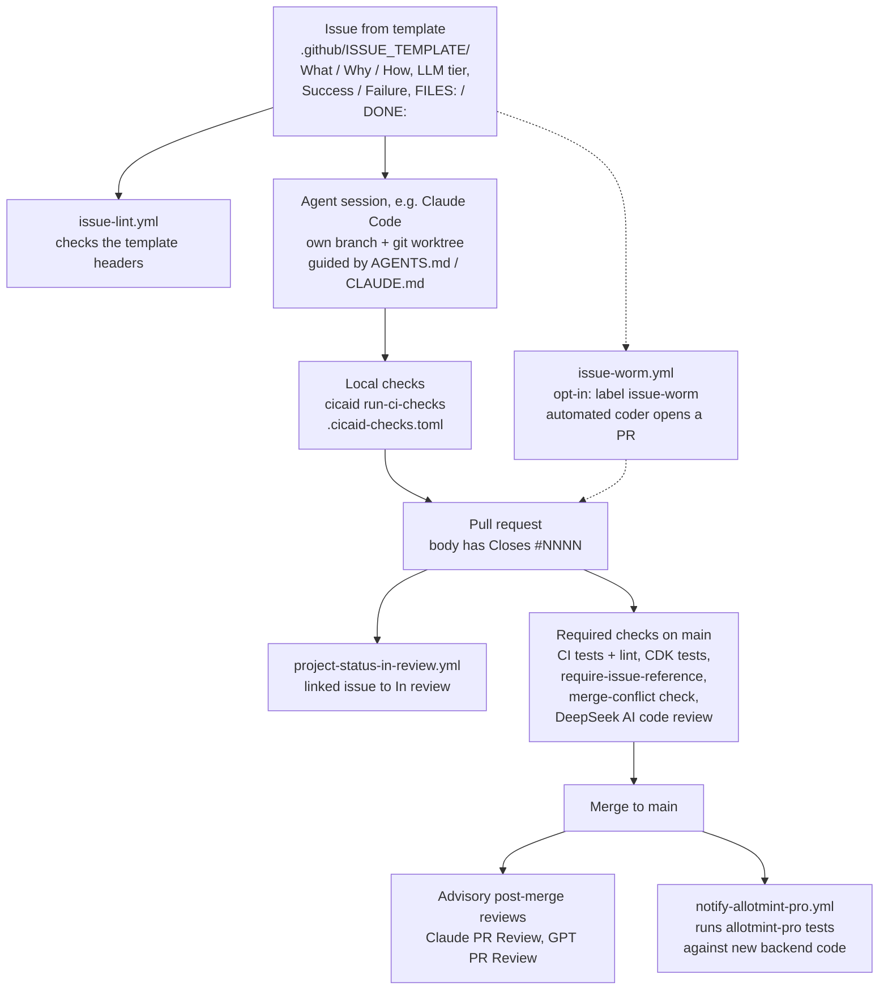
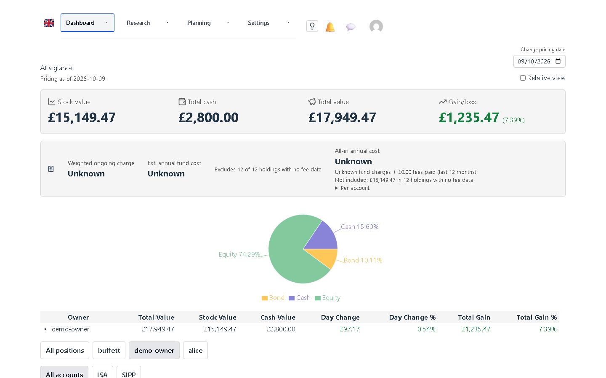
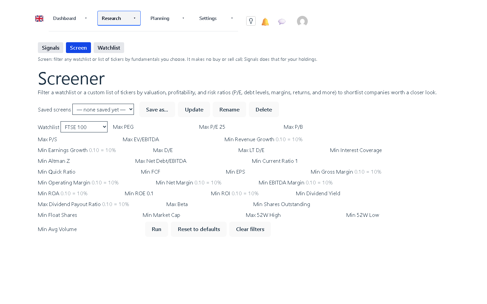
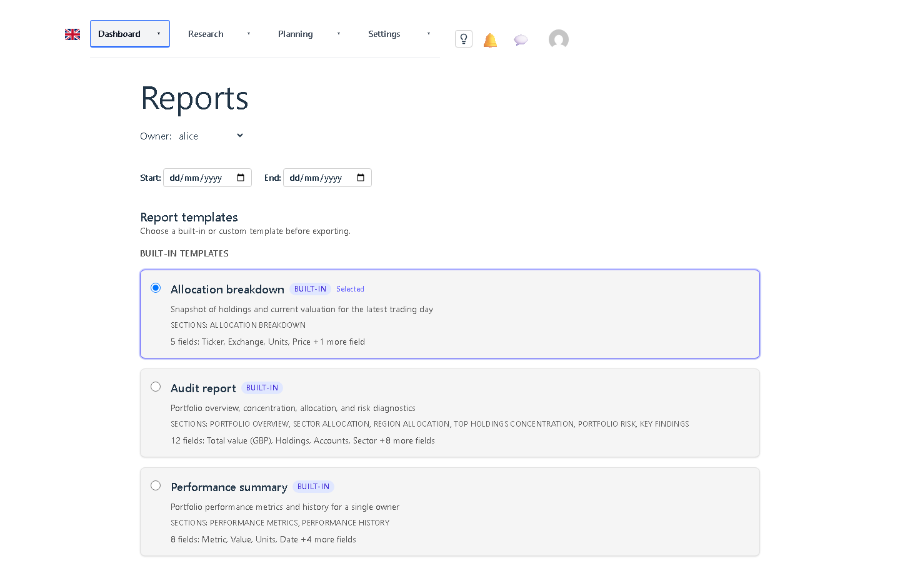
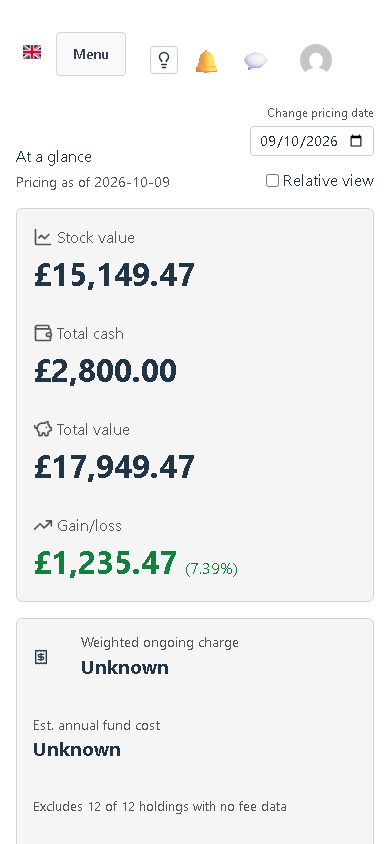
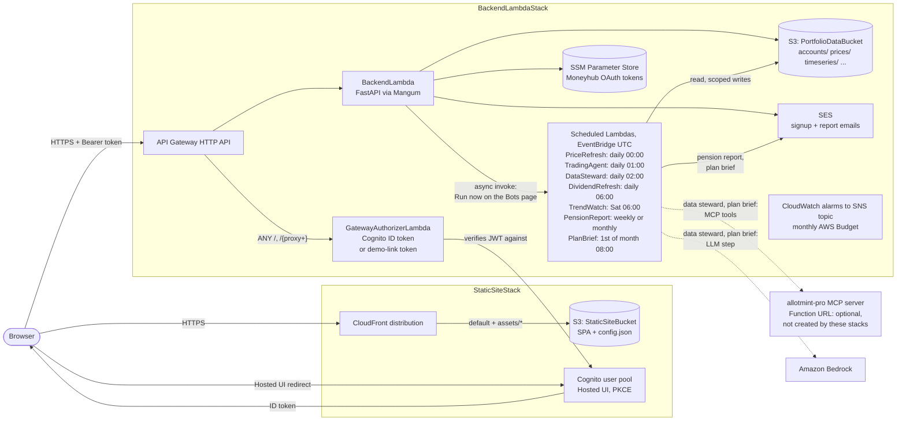
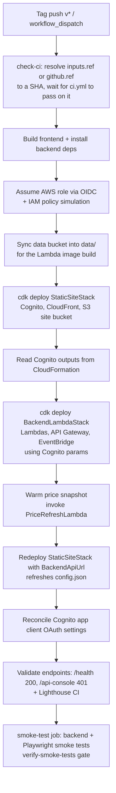

# AllotMint 🌱💷

[](https://github.com/leonarduk/allotmint/actions/workflows/ci.yml)
[](https://codecov.io/gh/leonarduk/allotmint)
[](LICENSE)

AllotMint is a family investing platform with a FastAPI backend, React/TypeScript frontend, and AWS deployment support.

## Open-core editions

This repository is the public AllotMint application shell. It boots and serves
the free portfolio-management routes without any private dependency. The paid
engine is distributed separately as the private
[`allotmint-pro`](https://github.com/leonarduk/allotmint-pro) package.

| Public application (this repo) | Private `allotmint-pro` package |
| --- | --- |
| FastAPI and React application, portfolio data and reports, authentication, and local/demo workflows | Fundamental screener engine |
| Built-in assistant (chat panel, `/chat` route, LLM provider selection, MCP client) | **MCP server** (`allotmint_pro/mcp_server/`) that the assistant and other MCP clients query for tools |
| Strategy stress tests using ETF stand-in sleeves (`backend/common/strategy_stress.py`) | **Strategy stress-test sleeve returns** (`strategy_stress`) that extend history past where the free ETF stand-ins start |
| | Risk (VaR and Sharpe) calculations, compliance rules, tax allowances, and anomaly repair |
| AWS CDK stacks in `cdk/`: the copy the deploy workflow runs today | A copy of the CDK stacks, being moved there under [#6796](https://github.com/leonarduk/allotmint/issues/6796) (see [AWS architecture](#aws-architecture)) |

Premium endpoints remain present in the public API contract. When
`allotmint-pro` is not installed, they return HTTP `402 Payment Required` with
an upgrade pointer instead of preventing the application from starting. Users
with access to the private package can install the integration extra with
`python -m pip install '.[pro]'`. The assistant also runs without it, but
there's no bundled MCP server then. It uses only its in-process tools unless
`MCP_SERVER_URL` points at another MCP server.

Real portfolio data is kept out of this repo. Locally the backend reads JSON
from `data_root` (`config.yaml`, overridable with `DATA_ROOT`). That can be a
checkout of the private `allotmint-data` repo or the demo fixtures under
`data/`. In AWS it reads the S3 data bucket (`DATA_BUCKET`).

## System overview

How the repos and runtime pieces fit together. Dashed lines are optional or
need configuration.



- **Built-in assistant**: `frontend/src/components/ChatPanel.tsx` posts to
  `/chat` (`backend/routes/chat.py`). The turn runs against the configured LLM
  provider, with MCP tools from `MCP_SERVER_URL`
  (`backend/chat/mcp_tools_client.py`, SigV4-signed for non-localhost Lambda
  Function URLs) merged with in-process tools such as page navigation and file
  export.
- **MCP server**: `scripts/run-mcp-server.ps1` and
  `scripts/bash/run-mcp-server.sh` start it locally with uvicorn on port 8001
  (`MCP_SERVER_PORT`). `GET /support/mcp-server/status`
  (`backend/routes/mcp_server_admin.py`) reports its URL and tool count. It
  is a standard Streamable HTTP MCP endpoint, so any MCP client can use it;
  this repo ships no Claude Desktop config.
- **allotmint-mcp** is a separate public repo: a standalone Java MCP server
  that calls this backend's REST API. It is an alternative to the Python MCP
  server in `allotmint-pro`, not a dependency of this app.

## How it's built

Most changes are written by AI coding agents working from issues. The repo is
set up so an agent can pick up an issue, work on it in isolation, and get
checked by CI before anything merges.



- Branch, worktree and PR rules: [docs/CONTRIBUTING.md](docs/CONTRIBUTING.md#branch-and-pr-policy).
  Parallel agent sessions each get their own worktree, so they don't share a
  dirty checkout.
- The required checks are listed in
  `.github/rulesets/default-branch-protection.json`. `require-issue-reference`
  is in `.github/workflows/pr-lint.yml`, and the DeepSeek review is
  `.github/workflows/deepseek-pr-review.yml`.
- The nightly **data steward** (`backend/data_steward/`) is an agent too. It
  triages data-quality issues through the MCP server's read-only tools and
  writes a ranked report, shown in the app's data-quality pages.

## Screenshots

| Portfolio view | Screener |
| --- | --- |
|  |  |

| Reports | Mobile |
| --- | --- |
|  |  |

## Language guidelines

All code, comments, commit messages, documentation, and PR/issue text in this
repository must be written in English only, regardless of the contributor's
or AI agent's default language.

- **Contributing**: [docs/CONTRIBUTING.md](docs/CONTRIBUTING.md) — environment variables, code quality expectations, and first PR walkthrough
- **Product and architecture overview**: [docs/README.md](docs/README.md)
- **Local setup and contributor workflow**: [docs/CONTRIBUTOR_RUNBOOK.md](docs/CONTRIBUTOR_RUNBOOK.md) — installation, running locally, testing, and pre-deploy checks
- **Deployment guide**: [docs/DEPLOY.md](docs/DEPLOY.md) — AWS CDK, environment setup, troubleshooting, and IAM permissions
- **User-oriented setup/readme**: [docs/USER_README.md](docs/USER_README.md)

## AWS architecture

Two independent CDK stacks (`cdk/stacks/static_site_stack.py`, `cdk/stacks/backend_lambda_stack.py`, wired up in `cdk/app.py`) make up the deployed system. The other modules in `cdk/stacks/` create no resources of their own: `moneyhub_token_store.py` scopes the SSM grant shown below, `prod_env.py` fails a `-c prod=true` synth when required environment variables are missing, and `exports.py` names the stack exports. The frontend is served by CloudFront directly from S3; the backend is a separate, CloudFront-less HTTP API. Cognito issues the ID token the browser sends as a bearer token. A Lambda authorizer on API Gateway checks that token, or a demo-link token, before the backend Lambda runs.

**Which CDK copy deploys:** `.github/workflows/deploy-lambda.yml` in this repo runs `cdk deploy` against this repo's `cdk/`, so that copy is what reaches AWS today. `allotmint-pro` has its own `cdk/`, which already differs from this one (it adds an MCP server Lambda and a monitoring dashboard). Moving the deploy there is tracked in [#6796](https://github.com/leonarduk/allotmint/issues/6796): [#6806](https://github.com/leonarduk/allotmint/issues/6806) adds the deploy workflow to `allotmint-pro`, and [#6808](https://github.com/leonarduk/allotmint/issues/6808) deletes `cdk/` here. Both are open. The diagrams below show this repo's copy.



`/health`, `GET /config`, `POST /token`, `POST /token/google`, `/signup/*` and `OPTIONS` preflights bypass the gateway authorizer (public or self-authenticating routes). Every other route goes through `GatewayAuthorizerLambda` (`backend/lambda_api/demo_authorizer.py`). It admits either a valid Cognito ID token or a scoped read-only demo-link token, and its result caching is disabled so token expiry is rechecked on every request. This replaced the native Cognito `HttpUserPoolAuthorizer` in [#7522](https://github.com/leonarduk/allotmint/issues/7522), which used to reject demo-link tokens at the gateway. See [docs/AUTH.md § Deployed-gateway auth](docs/AUTH.md#deployed-gateway-auth-the-democognito-lambda-authorizer-7522).

Every Lambda above is a container image built from `backend/Dockerfile.lambda`, each with its own entry-point `cmd`, and pushed to the CDK bootstrap ECR repository. The image contains only `backend/requirements.txt`, so `allotmint-pro` is not installed in it. These stacks also don't give the backend Lambda an MCP server URL or a Bedrock grant. The assistant's MCP tools are wired in local runs, or in deployments that set `MCP_SERVER_URL` some other way.

### CDK deployment pipeline

Deploys run from `.github/workflows/deploy-lambda.yml` on a `v*` tag push (or manual dispatch), gated on a `ci.yml` run passing first. The gate resolves the same ref the deploy job checks out (`inputs.ref || github.ref`) to a commit SHA and waits for `ci.yml` on that exact commit, so a manual dispatch with `inputs.ref` can't deploy a commit whose CI wasn't checked.



All diagrams in this README are Mermaid code blocks that render natively on GitHub. Edit them in place; there's no separate source file or regeneration step.

<details>
<summary>Diagram sources: re-check these when updating the diagrams</summary>

- **System overview:**
  - `backend/app.py`, `backend/common/core_optional.py`, `pyproject.toml` (`pro` extra)
  - `backend/routes/chat.py`, `backend/chat/providers.py`, `backend/chat/mcp_tools_client.py` (SigV4 for non-localhost URLs), `backend/chat/local_tools.py`
  - `backend/routes/mcp_server_admin.py`, `scripts/run-mcp-server.ps1`
  - `backend/chat/tool_switches.py` (data steward read-only allowlist), `backend/data_steward/`, `backend/bots/`
  - `backend/config.py` (`data_root` / `DATA_ROOT`), `config.yaml`, `config.lambda.yaml`
  - the `allotmint-pro` and `allotmint-mcp` READMEs
- **How it's built:**
  - `.github/ISSUE_TEMPLATE/`, `AGENTS.md`, `docs/CONTRIBUTING.md`, `.cicaid-checks.toml`
  - `.github/rulesets/default-branch-protection.json` (required checks)
  - `.github/workflows/`: `issue-lint.yml`, `issue-worm.yml`, `pr-lint.yml` (`require-issue-reference`), `deepseek-pr-review.yml`, `claude-pr-review.yml`, `gpt-pr-review.yml`, `project-status-in-review.yml`, `notify-allotmint-pro.yml`
- **AWS architecture:**
  - `cdk/app.py`, `cdk/stacks/*.py`
  - `backend/lambda_api/demo_authorizer.py`, `backend/Dockerfile.lambda`, `docs/AUTH.md`
- **Deployment pipeline:** `.github/workflows/deploy-lambda.yml` (the `check-ci`, `deploy`, `smoke-test` and `verify-smoke-tests` jobs)

</details>

## Design decisions

Key architectural tradeoffs made in this project:

- **JSON file storage over a relational DB**: AllotMint is a single-user tool with no concurrency requirements, so a relational database would add operational overhead without a corresponding benefit. Flat JSON keeps local dev dependency-free and makes fixture data trivial to inspect and edit by hand.
- **Cognito over custom auth**: Using AWS Cognito offloads JWT lifecycle management, MFA, and token rotation to a managed service rather than maintaining that logic in-house. The tradeoff is vendor lock-in to AWS's auth model and APIs.
- **Lambda + Mangum over a persistent server**: A pay-per-invocation Lambda fits the cost model of a low-traffic personal tool far better than an always-on server. The tradeoff is cold start latency, most notably the ~10-second Lambda INIT phase constraint tracked in [issue #4429](https://github.com/leonarduk/allotmint/issues/4429).
- **What would change at scale**: multi-user or high-traffic usage would justify swapping JSON storage for Postgres, introducing a proper job queue for background work, and splitting the single Lambda into per-domain functions to isolate cold starts and scaling behavior.

## Local development

This project uses JSON files under `data/` as its local "database" (see [JSON file storage](#design-decisions) above) — there's no local database server to set up.

- Inspect a fixture, e.g. an account's holdings: `cat data/accounts/demo/isa.json | jq '.'` (each owner under `data/accounts/<owner>/` has one JSON file per account type, e.g. `isa.json`, `sipp.json`)
- Edit fixture data directly with any text editor — e.g. add a position by editing the relevant JSON file under `data/accounts/<owner>/`
- Most routes read fixtures straight from disk, so edits take effect on your next request; a few expensive report pages are cached separately under `data/cache/` and refresh on a timer (see `backend/utils/page_cache.py`)
- Run the app against these fixtures with `bash scripts/bash/run-local-api.sh` (backend) and `npm --prefix frontend run dev` (frontend) — see [docs/CONTRIBUTOR_RUNBOOK.md](docs/CONTRIBUTOR_RUNBOOK.md) for the full local setup

## Coverage reporting

GitHub Actions uploads both backend (`coverage.xml`) and frontend (`frontend/coverage/lcov.info`) coverage reports to Codecov on pull requests and pushes to `main`.

## Local Docker development

Run the full AllotMint stack (backend + frontend) with real local fixture data.

### Prerequisites

- Docker Engine 24+
- Docker Compose v2 (`docker compose`)

### Quick start

1. Copy local environment defaults:

   ```bash
   cp .env.local.example .env.local
   ```

2. Start both services:

   ```bash
   make local-up
   ```

3. Open:

   - Frontend UI: http://localhost:3000
   - Backend API console (Swagger UI): http://localhost:6468/api-console
     (the default `/docs` route is disabled; `.env.local.example` sets
     `DISABLE_AUTH` and `LOCAL_LOGIN_EMAIL` so the console loads without a
     real login)

The backend bind-mounts `./data`, `./config.yaml`, and `./backend` into the
container, and runs with `--reload`, so both fixture data and code edits are
picked up live from your local repository checkout without rebuilding the
image.

### Stop services

```bash
make local-down
```

## Local network setup (LAN testing)

Use these steps when you want phones/tablets/laptops on your WiFi network to hit a backend running on your development machine.

### Prerequisites

- Python 3.11+ with dependencies installed:
  - `python -m pip install -r requirements.txt -r requirements-dev.txt`
  - (CI uses Python 3.12 as the primary backend version and runs a lightweight Python 3.11 compatibility smoke job)
- Node.js 20+ for frontend tooling.
- Local environment defaults:
  - `cp .env.local.example .env.local`

### Steps

1. Set runtime API base URL for the frontend in `frontend/public/config.json`:

   ```json
   {
     "apiBaseUrl": "http://<YOUR-LAN-IP>:6468"
   }
   ```

2. Start the backend and bind to all interfaces (`0.0.0.0`):

   ```bash
   bash scripts/bash/run-local-api.sh
   ```

3. Start the frontend:

   ```bash
   npm --prefix frontend run dev -- --host 0.0.0.0
   ```

4. Allow inbound TCP `6468` in your machine firewall so other LAN devices can reach the FastAPI backend.

### Notes

- `frontend/public/config.json` is fetched with `cache: "no-store"` in the SPA bootstrap and deployed with `Cache-Control: no-cache, no-store, must-revalidate` in CDK, so backend URL changes should take effect immediately.
- iOS Safari blocks mixed content (`https://...` frontend calling `http://...` API). For LAN testing, serve frontend over HTTP (or use HTTPS end-to-end).
- This project does not currently register a service worker, so `/config.json` is not intercepted by client-side SW caching.
